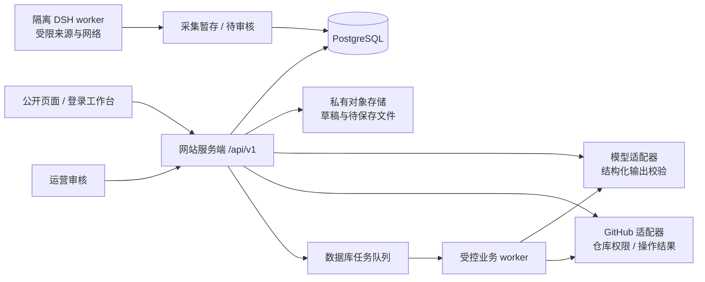
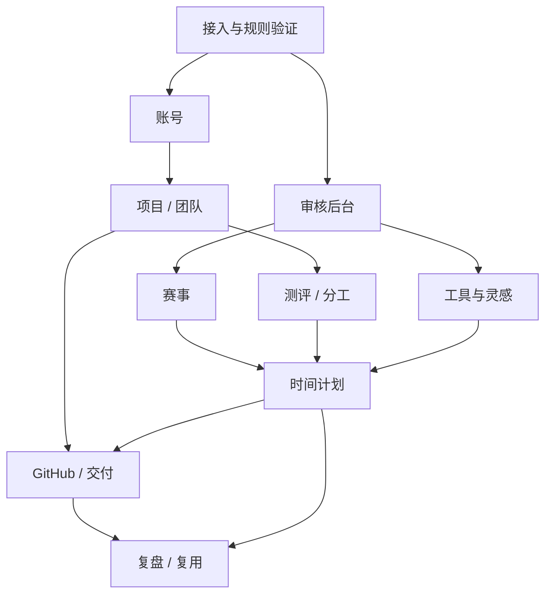

# 草根黑客松情报局 · 总体规划

2026-10-11 最新体验实施：[新人主路径与信息简化](23-新人主路径与信息简化.md)，宪法v1.14.1。面向黑客松新人突出当前主要行动，公开指引、我的参赛和团队执行各司其职；详情/资源/高级设置按需展开，主办方入驻前移。原功能、数据、直达和权限保留，按[本轮分工](../协作/新人主路径并行分工-2026-10-11.md)执行与验收。

2026-10-11 最新补充：[报名发布与专属入选通知](22-报名发布与专属入选通知.md)，宪法v1.13.0。主办方复制报名链接分享到社交平台，在本站审核并为通过者编辑/预览/发布专属通知；新增机构自配发信邮箱，真实SMTP认证后加密保存，官方通知优先使用本机构邮箱，登录验证码仍由平台发送。持久通知队列、正式规则映射与变更公告已根接入，根验收和实际部署分别记录。

2026-10-11 最新扩展：[主办方入驻与多赛事运营](21-主办方入驻与多赛事运营.md)，宪法v1.11.0与[O01–O04分工](../协作/主办方多赛事并行分工-2026-10-11.md)。同一网站承接多组织多赛事，选手进入对应赛事再进入自己的私人团队空间。采用模板/默认值、当前待办、按需高级设置；正式沟通、报名队伍、基础现场服务、正式收件/人工评分形成闭环，不开放私人备赛资料。当前文档与派发不代表实际功能已验收；下文为既有产品阶段记录。

2026-10-09 本轮最新依据：[任务式参赛与团队AI协作](19-任务式参赛与团队AI协作.md)、R01–R03及宪法v1.10.0。核心为新人的当前任务、团队交接与效率；个人目的/公开名片招募、原子草案领取、团队成果动态、独立空间AI继承本人导航记忆。旧模块复用，根统一实际迁移、组合、构建和验收，不把文档或派发当完成。

2026-10-09 最新空间实施依据：[详细指引树与DSH站内查找](18-团队空间详细指引树.md)、[首次登录与萌新验收](17-萌新全流程验收与首次登录指引.md)、[团队空间全流程工作台](16-团队空间全流程工作台.md)，对应宪法v1.9.0。常驻邀请、五入口、六段指引与任务交接复用现有事实，T01–T03及内部代理分工、主会话统一验收；下文旧版本和范围保留历史。

2026-10-09 体验改版补充依据：[体验优先与协作整合](13-体验优先与协作整合.md)。用户最新确认以方便顺手、通俗易懂为主，并新增官方赛道、自选/AI 分工、依赖和队内进度；本轮页面结构及模块任务按该文档、会话登记与宪法 v1.4.0 执行。下文保留原阶段规划历史，不表示全部已验收或仍需从零开发。

版本：规划草案 v0.3 · 2026-10-08  
对应宪法：v1.2.0。本文提供可实施方案，不代表技术选型、预算和上线日期已经批准。

## 1. 项目要解决什么

产品是一个带登录的黑客松参赛网站。公开区域帮助找比赛与工具，登录后围绕一个参赛项目完成规则确认、分工、计划和交付。

核心价值不是产生更多 AI 文本，而是把“我不知道接下来做什么”变成可执行的动作：
知道必交什么、由谁负责、何时完成、卡住时怎样删减，以及最后是否真的提交成功。

### 1.1 目标用户与场景

用户已确认：首批定位暂不限定，覆盖所有黑客松新人；不限定高校、成年人或已有技术基础。
第一版用途已确认：供少量真实参赛队伍试用。页面展示、数据保存和关键操作需要真实可用，演示原型可用于设计评审，但不能替代试用交付。

| 用户 | 典型障碍 | 产品帮助 |
| --- | --- | --- |
| 第一次参赛的个人 | 不会读规则，不知道最小作品范围 | 条款清单、必交材料、个人计划与工具入口 |
| 二至五人的新人队伍 | 不清楚能力与职责，时间互相冲突 | 简短提问、试做、分工确认、可用时间与依赖 |
| 非技术成员 | 不知道自己能贡献什么 | 需求、视觉、测试、文档、路演等明确交付物 |
| 有经验的队长 | 重复解释 GitHub，追问进度 | 统一项目、清楚状态、保存版本与交付核对 |

年龄不用于推断能力。用户是否能使用第三方账号与服务，需要在接入方案中核对；不能用本站账号绕过第三方要求。

### 1.2 已明确、推荐与待决定

| 类型 | 内容 |
| --- | --- |
| 用户已明确 | 网站、登录、赛事分析、AI 提问分工、任务时间规划、GitHub 简化、经验沉淀 |
| 用户新明确 | 参赛工具、AI 设计与审美参考、UI 组件资源库；暖白＋橙红视觉 |
| 用户最新扩展 | skill 分类与讲解、精选评价、游戏/影视/AI Agent 等赛道包、一键安装；按 AI 工具分类，目标支持主流工具 |
| 用户确认的试用方向 | 第一版给少量真实队伍试用；首批覆盖所有新人，暂不限定人群 |
| 推荐首版 | 公开阅读＋登录保存；邮箱验证登录候选；个人/团队项目；人工审核赛事；精选资源；有限 GitHub 保存流程 |
| 推荐架构 | TypeScript＋Next.js＋PostgreSQL 的模块化单体；隔离采集 worker；服务端模型适配器 |
| 尚未确定 | 开发人数、每周可投入时间、目标试用日期、月预算；登录供应商、部署位置、模型、首批来源、测评细则、数据保留期限、仓库新建深度 |

推荐方案不是额外强制需求。影响当前实现的选择通过小规模验证解决，其余记录为假设，不阻塞所有开发。

### 1.3 项目有没有机会

值得做一版试用，但最需要验证的是“比赛期间队伍是否愿意持续使用”。赛事导航、链接合集和通用 AI 问答容易被替代；围绕同一项目保留规则、分工、进度与交付记录，才可能形成复用价值。

资源库适合作为进入网站的轻入口：用户找一个按钮组件或设计参考，可以顺手保存到项目任务。
但浏览量不等于交付价值；如果核心工作台不好用，扩大链接数量不会解决问题。
技能库同样需要围绕实际任务。已有技能平台提供目录和套餐，本站的差异应通过黑客松中文教程、少量实测组合和项目经验验证；热度最高不能直接代表最适合参赛。

首轮验证三个假设：

1. 队伍能在较少解释的情况下完成首次项目设置，并说清必交材料。
2. 成员愿意确认分工并在比赛中更新进度，计划能帮助作出范围取舍。
3. GitHub 操作与正式提交状态足够清楚，能减少队长的重复指导。

## 2. 首版范围与完成定义

### 2.1 一条贯通流程

公开浏览赛事/资源 → 登录 → 创建个人或团队项目 → 关联赛事并确认关键条款
→ 邀请成员、填写意愿和可用时间 → AI 提问/试做 → 确认分工
→ 生成并检查计划 → 更新任务进度/调整范围 → GitHub 保存版本
→ 核对材料并记录正式提交 → 完成复盘、保留工具与经验。

跳过测评、使用手动分工或暂不连接 GitHub，仍可使用项目与计划。四项核心能力在首版都保留，但各自只做一个稳定路径。

### 2.2 按模块约束首版

| 模块 | 首版必须可用 | 暂不进入首版 |
| --- | --- | --- |
| M01 账号 | 登录、退出、会话失效、恢复、私人项目隔离 | 多套社交登录、复杂组织 SSO |
| M02 项目 | 个人/团队项目、过期可撤销邀请、角色、成员列表 | 陌生人匹配、公共群聊 |
| M03 赛事 | 小规模审核赛事、来源证据、时间/资格/材料、分析草案 | 全网自动“正规性”判定、保证奖金兑现 |
| M04 分工 | 有版本的题目与量规、意愿/试做证据、分工建议与编辑 | 科学能力排名、自动依据年龄分岗 |
| M05 计划 | 可用时间、依赖、必需/可选任务、缓冲、重规划差异 | 保证按时、未经成员更新自动认定完成 |
| M06 GitHub | 授权选中已有仓库、变更预览、独立分支保存、真实结果 | 完整 Git 客户端、复杂自动冲突合并、任意代码运行 |
| M07 复盘 | 材料清单、来源标明的提交记录、复盘与复制参考 | 自动评定队员贡献、公开排行榜 |
| M08 后台 | 采集草稿、人工审核发布、失败重试、资源维护 | 所有来源无人值守发布、通用远程执行平台 |
| M09 资源 | 精选链接、用途/费用/门槛/技术栈、筛选、收藏到项目 | 全网图片镜像、社区交易、大量自动排名 |
| M10 技能扩展 | 主流 AI 工具分类、用途教程、许可与兼容证据、固定版本赛道包、已验证安装指导 | 未经验证承诺全部兼容、未许可打包、浏览器假装已写本机、默认覆盖现有技能 |

README/PPT 首版提供结构化大纲与可编辑文本导出。PPTX 自动排版、自动部署作品及跨平台自动提交后置，不能让“生成大纲”显示为作品已经交付。
M10 是新增独立范围：目录、教程和套餐可先交付，真正本机一键安装需本地桥接与各工具适配验证。用户的主流支持目标保留，分批达到实测门槛后开放对应组合；新增工作量另计，不阻塞九模块核心流程。详见 [M10 独立规划](模块/10-技能库与赛道技能包.md)。

### 2.3 首版整体验收

本节是已确认的真实队伍试用门槛。暂未实现或仅模拟的功能必须标明，不能成为试用中唯一的操作路径。

- 一个队伍从登录走到提交记录，过程中不依靠后台直接改数据才能继续。
- 至少一条真实测试仓库保存流程跑通；模拟接口只用于失败覆盖，不作为真实接入证据。
- 断网、模型不可用、成员未测评、GitHub 授权失效时，已保存资料与草稿仍可取回。
- 用户可以区分赛事原文、AI 建议、人工确认；可以区分仓库保存、运行验证和赛事提交。
- 私人项目、个人原始测评回答、仓库凭据的权限验证覆盖服务端。
- 资源库至少有各阶段的代表条目，能筛选并收藏；不为达到数量而发布未核验信息。
- 已开放的技能功能必须准确展示许可、工具版本/系统与验证状态；复制命令、文件安装、加载和示例验证分开。未开放能力明确说明，不用演示回执替代真实安装。

## 3. 信息架构与页面

### 3.1 两套导航共用一个品牌

公开导航：赛事情报｜工具与灵感｜技能与赛道包｜参赛指南｜我的工作台｜登录。
项目导航：概览｜赛事要求｜成员与分工｜任务与时间｜仓库与交付｜资料与灵感｜复盘。
后台入口只对运营角色显示，服务端另行校验权限。

| 路由建议 | 页面职责 | 权限 |
| --- | --- | --- |
| `/` | 清楚介绍价值，赛事与资源双入口 | 公开 |
| `/events`、`/events/:eventId` | 赛事筛选、来源和条款分析 | 公开阅读；登录保存 |
| `/resources`、`/resources/:resourceId` | 工具/AI 设计/UI 组件、筛选、详情 | 公开阅读；登录收藏 |
| `/skills`、`/skills/:skillId`、`/kits`、`/kits/:bundleId` | 按 AI 工具选择技能/赛道包、教程、版本与兼容证据 | 公开阅读；本人安装计划需登录 |
| `/guides` | 少量经过编辑的参赛指导 | 公开 |
| `/login`、`/account` | 登录、会话、授权与数据管理 | 本人 |
| `/app` | 个人项目列表、最近操作与下一步 | 登录 |
| `/app/projects/:projectId` | 项目概览 | 项目成员 |
| `.../rules` | 本项目规则快照与确认 | 项目成员；管理动作限管理员 |
| `.../team`、`.../assessment` | 邀请、意愿、本人提问、共享摘要、分工 | 按数据可见范围区分 |
| `.../plan` | 任务、可行性、版本与进度 | 项目成员；应用计划限管理员 |
| `.../delivery` | 仓库、文件变更、材料与提交记录 | 项目权限与 GitHub 权限共同决定 |
| `.../resources`、`.../retrospective` | 项目资料、工具经验、复盘 | 项目成员 |
| `/admin/events`、`/admin/resources`、`/admin/jobs` | 审核、维护、失败队列 | 运营角色 |

M09 与 M02 的收藏落入同一资料页；不再做第二份互相不同步的“项目资源集合”。

### 3.2 首页与工作台的内容区别

首页解释“怎么开始”，可以用大字、留白、栏目卡片表达品牌。
工作台回答“现在该做什么”，把必交项、阻塞与下一步放在视觉优先位置。资源推荐作为可选附件，不能抢占临近截止的关键任务位置。

## 4. 系统设计建议

### 4.1 首选简单结构

网站采用模块化单体：每个模块有明确业务服务和数据边界，不一开始拆微服务。
长任务使用数据库记录与 worker 处理；需要更高吞吐时再引入专门队列。DSH 独立运行，不获得 GitHub 凭据、用户原始回答或网站数据库管理权限。

Next.js 的服务端鉴权应落在数据访问与服务操作层，不能只依赖页面导航限制。
具体认证库留给 S0 选择和验证。[Next.js 官方认证指南](https://nextjs.org/docs/app/guides/authentication)

### 4.2 模块边界

| 边界 | 数据所有者 | 其他模块怎样使用 |
| --- | --- | --- |
| 账号与会话 | M01 | 验证登录身份；不接收模型推断身份 |
| 项目、成员、邀请 | M02 | 所有私人模块先检查项目成员权限 |
| 赛事与来源、规则分析 | M03；发布由 M08 | 项目使用有版本的规则快照 |
| 题目、回答、评分、分工 | M04 | 计划读取共享摘要和已确认分工，不读取其他人的原始回答 |
| 任务、依赖、窗口、计划 | M05 | 交付与复盘读取生效版本；不直接覆盖计划表 |
| 仓库绑定、操作、提交记录 | M06 | 明确提供真实保存/提交状态与来源 |
| 复盘与复制参考 | M07 | 下一次项目复制为草稿，日期与工时重新确认 |
| 采集/审核、发布记录 | M08 | 公共数据经审核后由 M03/M09 对外读 |
| 资源与分类 | M09 | 运营维护；个人/项目收藏按 M01/M02 的权限保存 |
| 技能版本、赛道包、兼容与安装计划 | M10 新增规划；发布经 M08 | M09 提供入口，M02/M05 引用固定版本；本机操作使用受控适配器 |

计划生效、规则确认、任务状态和仓库写入均保留版本或操作记录。
跨模块异步通知按“可能重复”设计，消费端幂等；只有真实存在的通知需求才使用事件，不需要引入复杂消息总线。

### 4.3 AI 的职责边界

AI 做条款整理、追问、证据摘要、任务拆解建议和文案草稿。
权限、评分公式、时间校验、依赖检查、文件路径检查、仓库写入与成功判定由确定规则执行。

每次生成记录输入快照引用、模型/提示版本、开始结束、结果和错误。
AI 结果先保存为草案，再校验并展示给用户确认。计划不因生成成功自动成为生效版本；GitHub 不因 AI 提议自动写入。
模型输出资源时只接受已审核 Resource ID，缺项时显示“暂无合适资源”，不让 AI 补造网址。

### 4.4 必须独立的状态

| 状态 | 能证明什么 | 不能替代什么 |
| --- | --- | --- |
| 已登录 | 本站已识别账号 | GitHub 仓库授权 |
| 赛事已审核 | 本站保存过核验来源 | 主办方后续不会改规则 |
| 计划已确认 | 队伍选择当前安排 | 必然按时完成 |
| 版本已保存 | GitHub 返回并核实提交结果 | 代码运行通过 |
| 运行已验证 | 有对应验证证据/用户报告 | 赛事正式提交 |
| 提交已记录 | 留存平台回执或用户自报 | 凭空声称获奖或提交已被平台接收 |
| 技能安装命令已复制 | 用户获得命令 | 本机已安装或 AI 工具已加载 |
| 技能文件已安装 | 有相应客户端文件核验回执 | 示例任务通过或作品完成 |

## 5. 开发顺序与工作量

### 5.1 S0：先验证最可能卡住的依赖

产出可查验的技术记录，而不是只写“可以接入”。

1. 选两至三个赛事来源，确认条款能否合法稳定读取、日期是否可定位；DSH 不可用时人工录入是否可行。
2. 用测试 GitHub App 和测试仓库验证已有仓库授权、读目录、一次多文件提交、独立分支、PR 与并发失败恢复。
3. 新建仓库单独验证 endpoint、token 类型、所需权限；未通过则首版只连接已有仓库。
4. 选一套登录方案，验证服务端会话、退出、恢复和私有页面/API 隔离；核验邮件可达性。
5. 对一组输入验证 AI JSON 格式、缺失值、超时与成本记录；确定量规草案和一份不依赖模型的计划检查器。
6. 人工核验第一批资源，确认“链接库”无需登录外部网站也能展示清楚的适用说明。

### 5.2 可调整的实施阶段

以下为有完整项目经验的一名全职开发者的规划估算，按已有服务可接入、限制首版范围计算；不包含第三方审批等待，也不是交付承诺。

| 阶段 | 产出 | 估算人日 | 完成门槛 |
| --- | --- | --- | --- |
| S0 可行性验证 | 上述接入记录、选择与回退方案 | 3–5 | 关键路径能演示真实结果，或明确缩减范围 |
| S1 基础与项目 | M01/M02、数据库迁移、公共/项目布局 | 7–10 | 登录、邀请、隔离与数据恢复可用 |
| S2 赛事与审核 | M03＋M08 赛事部分 | 4–6 | 一场赛事从来源到项目规则确认 |
| S3 提问与分工 | M04 | 4–6 | 本人回答、团队摘要、分工编辑贯通 |
| S4 时间计划 | M05 | 6–9 | 可行/不可行例子、更新与版本差异正确 |
| S5 GitHub 与交付 | M06 | 6–9 | 真实仓库保存、冲突/失效保留草稿、提交记录 |
| S6 资源与复盘 | M09/M07＋M08 资源部分 | 3–5 | 精选筛选收藏、复盘与复制草稿 |
| S7 试用与修正 | 核心贯通验证、设计和可访问性检查、试用修正 | 5–8 | 关键验收通过、阻塞问题清零 |

合计约 38–58 人日；预留约 20% 不确定性，安排约 46–70 人日，即约 9–14 个全职工作周。
兼职按实际每周可用时间重算。多人可以并行页面与独立模块，但权限、共享数据与贯通验证仍需要集成时间，不能简单除以人数。
视觉设计可与 S0/S1 并行；资源库的少量公开链接可早于完整 M09 上线。
上述 38–58 人日与 46–70 人日安排仅覆盖原 M01–M09，不含新增 M10。M10 先完成工具/许可可行性验证，再独立估算目录、教程、赛道包、本机桥接及多环境持续复测；不能把主流适配视为一次开发后永久免费维护。

### 5.3 如果只给四周

把目标改为可试用原型：登录与项目、人工录入赛事分析、手动分工加简短提问、规则校验的计划草案、精选资源导航与 GitHub 原生流程指引。
接入时间不足时不展示虚假的网站内仓库保存。原型明确记录缺失功能，后续补齐本规划中的正式首版范围。

### 5.4 模块依赖

图中为信息依赖，不要求全部串行开发。接口契约稳定后，M03/M04/M06/M09 可并行。
M09 不是生成计划的硬性前置条件；资源服务故障时仍应生成不带资源的计划。
M10 依赖 M08 审核与独立工具适配证据，项目引用通过 M02/M05 明确接入；不要求先完成全部安装器才能生成参赛计划，也不改用 M09 资源状态代表安装事实。

## 6. 验证、性能与运维

### 6.1 用真实行为验证

| 验证层 | 必须覆盖 |
| --- | --- |
| 业务规则 | 权限、量规版本、计划依赖/时区/窗口、路径、版本冲突 |
| 数据集成 | 邀请重复加入、事务回滚、成员退出、幂等、规则/计划版本 |
| 外部集成 | 真实测试 GitHub 仓库、采集来源、邮件登录；失败场景可模拟 |
| 核心流程 | 登录→队伍→规则→分工→计划→保存→提交记录→复盘 |
| 人工使用 | 新人能说明下一步和三种交付状态；手机能更新进度 |
| 视觉检查 | 键盘导航、对比度、长中文、无结果、失败与离线、减少动效 |

不为纯文案或低影响样式制造重复实现的自动化测试。自动测试优先用于权限、数据、计算与外部写入。

### 6.2 建议测量目标

这些是实施阶段的目标值，需要以指定环境验证后报告；不是当前产品已经达成的性能。

- 普通读取 API 在首批试用规模下测量 P50/P95，建议 P95 ≤ 800 ms；排除外部生成，用日志区分原因。
- 正常页面不能等待 AI 才显示已保存内容。长任务先返回 jobId，显示真实状态，可离开后继续查看。
- 公共页面移动端建议 LCP ≤ 2.5 s、INP ≤ 200 ms、CLS ≤ 0.1，以现场指标和测试环境分别记录；参照 [web.dev 官方阈值说明](https://web.dev/articles/vitals)。
- 可访问性目标 WCAG 2.2 AA；产品按钮建议至少 44 px 高，此为易点按的设计目标，并非宣称 AA 必须 44 px。[W3C 官方速查](https://www.w3.org/WAI/WCAG22/quickref/)
- AI 设每项目每日调用预算、输入长度与超时上限；实际数值用 S0 测量决定。超额显示手动替代路径，不能静默消费。
- 无原始回答/令牌的操作日志；记录任务错误类别、外部请求标识、重试次数。运营可以定位失败但不会因此获得全部私人数据。

### 6.3 部署与数据

开发、预发布、生产分环境。预发布使用测试账号、测试仓库与标明的演示赛事。
数据库迁移提交版本，正式迁移前备份；恢复演练必须能恢复项目、任务与操作记录。
私有文件使用受控下载，设清理/保留策略；删除个人数据与项目共享数据之间的影响需在 M01/M02 定义。
公开资源访问失败、AI 故障或 DSH 中断不阻止读取生效计划与下载已保存草稿。

国内目标用户的访问延迟、第三方连通性与部署/账号适用要求，应按最终服务地点评估；目前没有选定云厂商或完成相应审查。

## 7. 试用与迭代

已确认以少量真实参赛队伍试用作为第一版目标，首批用户暂不限定，覆盖所有新人。
建议邀请两至三个愿意完整使用流程的队伍，并补充个人参赛场景观察；具体人数仍为建议。
用不同技术基础、职责、参赛经验和工具使用状态选择代表场景，不把年龄当能力标准。
先做一场低风险演练，再在真实比赛中观察；访谈与数据均征得适当同意，避免收集与功能无关的信息。

### 7.0 代表场景与试用准备

| 场景 | 重点观察 |
| --- | --- |
| 非技术成员或第一次使用 GitHub 的成员 | 能否在不预先连接 GitHub 的情况下参与分工与进度；能否理解首次建库/保存引导 |
| 有开发经验但第一次参赛的成员 | 能否读懂规则、缩减范围、完成材料与正式提交 |
| 技术与非技术混合队伍 | 设计、需求、测试、文档和路演任务是否有明确负责人与交付物 |
| 学生/青少年新人场景 | 是否理解语言、账号与分享范围；第三方功能受限时是否仍有可继续的手动路径 |
| 个人参赛 | 无需创建虚假队伍，是否能完成个人计划和交付核对 |

试用前准备一份简短任务脚本、清楚的反馈入口和问题处理负责人。
观察完成动作、耗时、阻塞与恢复方式，避免只收集“页面好不好看”。
先解决阻止用户继续或可能丢失成果的问题，再优化装饰动效。

### 7.1 建议指标

| 指标 | 定义 | 决策用途 |
| --- | --- | --- |
| 首次设置完成率 | 创建项目者中确认规则、成员与至少一项任务的比例 | 是否被初始表单卡住 |
| 分工采用率 | 建议被确认/修改后实际使用的队伍比例 | 测评是否减少讨论成本 |
| 进度维护成本 | 成员一次更新花费时间与放弃原因 | 简化工作台 |
| 范围取舍次数 | 队伍主动删减可选项并记录理由 | 计划是否产生行动 |
| 保存恢复成功率 | 失败后草稿可取回并最终保存的操作比例 | GitHub 助手可靠性 |
| 正式提交证据 | 记录来源与回执，不只看用户点击按钮 | 核心交付是否贯通 |
| 资源有用度 | 收藏被关联到任务/复盘、是否减少搜索时间 | 资源库是否只是闲逛入口 |
| 下次复用 | 再参赛时引用旧经验的用户数量/反馈 | 长期价值 |

不预先许诺某个转化率。小样本先看具体阻塞和定性反馈；统计必须注明样本量，不能把试用结果包装成普遍结论。

## 8. 风险与应对

| 风险 | 早期信号 | 应对 |
| --- | --- | --- |
| 范围过大 | 每个模块都做成完整平台 | 保持贯通路径，按首版表删减 |
| 测评看起来精确却不可比较 | 分数不同被当作能力差距 | 展示证据和量规；不排名；允许手动分工 |
| 计划只好看不可执行 | 忽略学习、休息、集成和提交时间 | 确定性校验、不可行提示、任务反馈重算 |
| 赛事信息过期 | 来源规则改了但项目没提示 | 版本快照、核验时间、变更对比与再确认 |
| GitHub 集成被权限卡住 | 把登录当授权，组织仓库不可操作 | S0 真实测试、窄授权、保留原生流程回退 |
| 链接库失去质量 | 无用途说明、费用过期、推荐数量压倒选择 | 人工精选、失效状态、按任务给少量选项 |
| 技能包质量与兼容失真 | 用安装量作效果评分；缺依赖、浮动版本、同名覆盖 | 任务测试与热度分开；固定版本、环境矩阵、冲突预检与恢复 |
| 技能内容分发不满足许可 | 公开仓库被当成可随意打包，忽略目录与素材例外 | 分别核验许可并保留必要声明；未知仅外链说明 |
| AI 设计与组件组合失控 | 三套组件风格混用、代码不可运行 | 选一套基础体系，逐项验证依赖/许可/可访问性 |
| 用户不更新进度 | 计划状态长期停留初始值 | 低成本更新、显示最后更新时间，不编造完成度 |
| 外部调用成本上涨 | 每次页面查看重复生成 | 输入版本复用、预算、按需触发、手动替代 |

## 9. Constitution Check

| 原则 | 本规划的落实 |
| --- | --- |
| I 可执行流程 | 同一项目贯通四项核心功能，资源与复盘辅助真实任务 |
| II 证据 | 赛事与资源保留来源、时间；费用/许可/截止未知需标明 |
| III 分工 | 固定量规和证据摘要；不以百分比宣称真实能力 |
| IV 时间 | 可用窗口、必需/可选、依赖、缓冲和不可行反馈 |
| V GitHub | 登录/授权分离，预览、真实状态、并发恢复 |
| VI 权限 | 私人数据服务端隔离，DSH 与仓库凭据分离 |
| VII 可维护 | 模块化单体、明确所有者、适配器、迁移 |
| VIII 验证 | 真实接入与模拟失败分开，核心流程验收 |
| IX 失败继续 | 持久草稿、手动路径、限次重试、成本与性能测量 |

当前规划没有授权跳过上述原则。技术假设在进入对应模块实现时验证，未通过须调整方案并记录。
M10 进一步落实固定技能版本、许可证依据、主流工具环境矩阵、本机明确授权、部分失败恢复与真实安装状态，逐项检查见其独立规划。

## 10. 下一步可执行清单

1. 选首批赛事与资源，形成来源清单；冻结 M01/M02 最小数据权限契约。
2. 完成 S0 登录、GitHub 和采集验证，记录真实支持范围。
3. 以视觉设计中的首页、赛事详情、项目概览、资源库四页做原型审阅。
4. 开始 S1，每次交付一个可观察的用户流程；按独立模块计划拆成 issue 或任务。
5. 进入真实试用前完成跨模块验收与数据恢复检查，再决定发布时间。

开发人数、每周投入、目标日期和预算尚未收到用户答复；当前工作量估算继续保留原假设，不据此自动设定实际排期或购买服务。

相关文档：[模块目录](README.md)、[协作约定](10-数据与接口协作约定.md)、[视觉设计](../设计/网页视觉设计.md)。
