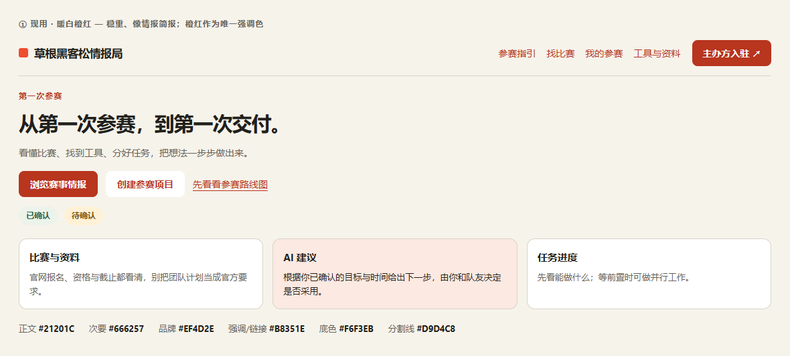
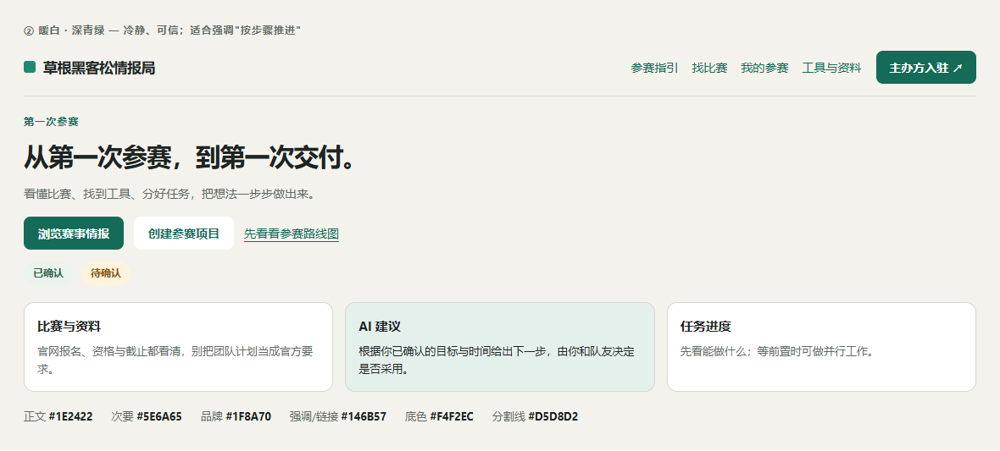
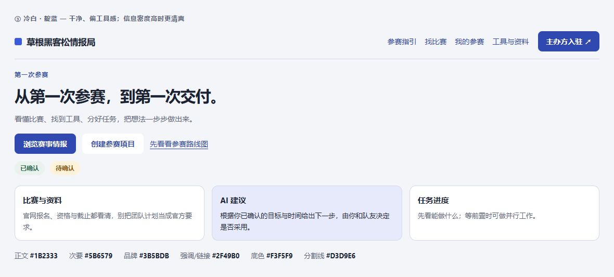
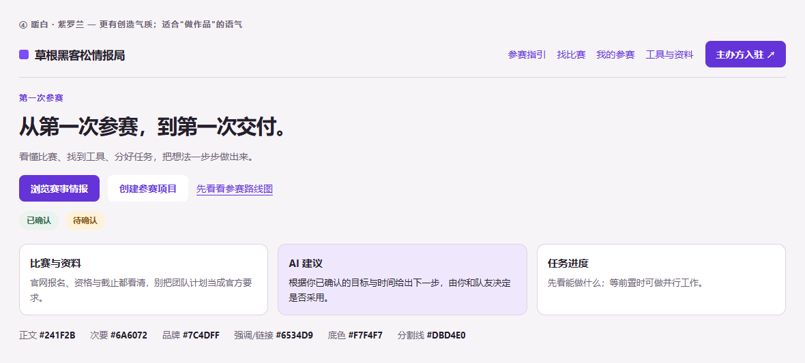
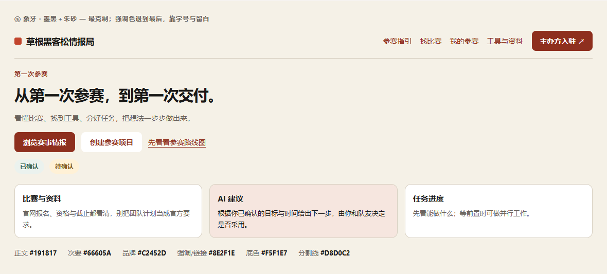

# 配色方案（5 套）· 2026-10-13

**依据**：[网页视觉设计](../设计/网页视觉设计.md) 第 4.1 节的 token 体系。已确认方向是"暖白＋橙红，情报编辑部风格"，
本文件给的是**在此基础上可替换的 5 套完整 token**，不是另起一套设计语言。

**方法**：每套都按现有 token 命名完整给出，并用脚本逐一校验 WCAG 对比度；
再用真实组件样例（站点头部、主标题、按钮、卡片、状态标签）渲染成图，
图片在 [`docs/设计/配色预览/`](配色预览/)。

**结论先说**：**5 套全部通过对比度校验，0 项不合格。**
门槛：正文/链接对底色 ≥ 4.5:1，按钮白字对按钮底色 ≥ 4.5:1，品牌色块/大标题 ≥ 3:1。

---

## ① 现用 · 暖白橙红（基准）

> 稳重、像情报简报；橙红作为唯一强调色。

| Token | 色值 | 用途 |
| --- | --- | --- |
| `--paper` | `#F6F3EB` | 全站暖白背景 |
| `--surface` | `#FFFFFF` | 表单、关键资料表面 |
| `--space-component-surface` | `#FFFDF8` | 空间组件暖白底 |
| `--ink` | `#21201C` | 标题、正文 |
| `--muted` | `#666257` | 次级说明 |
| `--brand` | `#EF4D2E` | 品牌图形、大字强调 |
| `--action` | `#B8351E` | 白字主按钮、链接 |
| `--action-hover` | `#9C2A17` | 主按钮悬停 |
| `--tint` | `#FBE9E2` | AI 建议/资源提示浅底 |
| `--line` | `#D9D4C8` | 装饰分隔线 |
| `--control-line` | `#7D776C` | 表单交互边界 |
| `--success`/`--success-bg` | `#2C6647` / `#ECF3EB` | 已确认 |
| `--warning`/`--warning-bg` | `#845311` / `#FFF1D6` | 待确认、时间风险 |

**关键对比度**：正文 14.7:1 · 链接 5.31:1 · 按钮白字 5.89:1 · AI 提示底 13.86:1。

---

## ② 暖白 · 深青绿

> 冷静、可信；适合强调"按步骤推进"，是最贴近"工具/说明书"气质的一套。

| Token | 色值 |
| --- | --- |
| `--paper` | `#F4F2EC` |
| `--surface` | `#FFFFFF` |
| `--space-component-surface` | `#FFFEFA` |
| `--ink` | `#1E2422` |
| `--muted` | `#5E6A65` |
| `--brand` | `#1F8A70` |
| `--action` | `#146B57` |
| `--action-hover` | `#0F5645` |
| `--tint` | `#E4F0EC` |
| `--line` | `#D5D8D2` |
| `--control-line` | `#6E7A75` |
| `--success`/`--success-bg` | `#2C6647` / `#EAF3EC` |
| `--warning`/`--warning-bg` | `#845311` / `#FFF3DC` |

**关键对比度**：正文 14.1:1 · 链接 5.74:1 · 按钮白字 6.42:1 · 品牌块 3.81:1。

---

## ③ 冷白 · 靛蓝

> 干净、偏工具感；信息密度高（比赛列表、任务表）时更清爽。

| Token | 色值 |
| --- | --- |
| `--paper` | `#F3F5F9` |
| `--surface` | `#FFFFFF` |
| `--space-component-surface` | `#FBFCFE` |
| `--ink` | `#1B2333` |
| `--muted` | `#5B6579` |
| `--brand` | `#3B5BDB` |
| `--action` | `#2F49B0` |
| `--action-hover` | `#263C93` |
| `--tint` | `#E6EAFB` |
| `--line` | `#D3D9E6` |
| `--control-line` | `#6C7793` |
| `--success`/`--success-bg` | `#2A6B4F` / `#E9F2ED` |
| `--warning`/`--warning-bg` | `#8A5512` / `#FFF2DA` |

**关键对比度**：正文 14.41:1 · 链接 7.12:1 · 按钮白字 7.78:1 · 品牌块 5.19:1（本组品牌色对比度最高）。

**注意**：这套的底色由暖转冷，与已确认的"暖白"方向差异最大，属于**改方向**而非换强调色。

---

## ④ 暖白 · 紫罗兰

> 更有创造气质；适合"做作品"的语气，和"黑客松"的创造感呼应。

| Token | 色值 |
| --- | --- |
| `--paper` | `#F7F4F7` |
| `--surface` | `#FFFFFF` |
| `--space-component-surface` | `#FEFCFE` |
| `--ink` | `#241F2B` |
| `--muted` | `#6A6072` |
| `--brand` | `#7C4DFF` |
| `--action` | `#6534D9` |
| `--action-hover` | `#5428BC` |
| `--tint` | `#EFE8FD` |
| `--line` | `#DBD4E0` |
| `--control-line` | `#7A6F84` |
| `--success`/`--success-bg` | `#2F6A4C` / `#EAF3ED` |
| `--warning`/`--warning-bg` | `#8A5512` / `#FFF2DA` |

**关键对比度**：正文 14.73:1 · 链接 6.31:1 · 按钮白字 6.89:1 · 品牌块 4.41:1。

---

## ⑤ 象牙 · 墨黑＋朱砂

> 最克制；强调色退到最后，靠字号与留白说话。最贴近"情报编辑部"的观感。

| Token | 色值 |
| --- | --- |
| `--paper` | `#F5F1E7` |
| `--surface` | `#FFFFFF` |
| `--space-component-surface` | `#FFFDF6` |
| `--ink` | `#191817` |
| `--muted` | `#66605A` |
| `--brand` | `#C2452D` |
| `--action` | `#8E2F1E` |
| `--action-hover` | `#742416` |
| `--tint` | `#F6E6DF` |
| `--line` | `#D8D0C2` |
| `--control-line` | `#7A7264` |
| `--success`/`--success-bg` | `#33604A` / `#EBF2EE` |
| `--warning`/`--warning-bg` | `#845311` / `#FFF1D6` |

**关键对比度**：正文 15.72:1 · 链接 7.23:1 · 按钮白字 8.15:1 · 品牌块 4.45:1（正文对比度最高）。

---

## 怎么在真实页面上对比（已实现）

5 套方案已做成**可切换皮肤**：

- 皮肤定义在 `src/styles/globals.css`，通过 `<html class="palette-N">` **只覆盖颜色变量**，不碰布局与组件样式。
- 切换入口在页头 **「我的账号」菜单 → 配色**（组件：`src/components/palette-switcher.tsx`）。
- 选择记在 `localStorage`，刷新后保留。默认（方案①）不挂 class。

**已验收**（`tests/e2e/palette-switcher.spec.ts`，真实浏览器）：

| 状态 | `--paper` | `--action` | `html class` |
| --- | --- | --- | --- |
| 默认 | `#f6f3eb` | `#b8351e` | 无 |
| 切到靛蓝 | `#f3f5f9` | `#2f49b0` | `palette-3` |
| 刷新后 | `#f3f5f9` | `#2f49b0` | `palette-3`（记住选择） |
| 切回默认 | `#f6f3eb` | `#b8351e` | 无 |

### 定稿后怎么固定

选定某套后，把它的色值写进 `globals.css` 的 `:root`，然后可以删掉 `palette-switcher.tsx` 与其样式
（切换器只是预览工具，不是产品功能）。

### 切换覆盖范围的诚实说明

换肤对**使用变量**的组件立即生效，但代码里还有大量**写死的色值**：

| 类别 | 数量 | 说明 |
| --- | --- | --- |
| 与本项目 token 同值、可直接换成变量 | **302 处** | 例如把 `#b8351e` 换成 `var(--action)`。集中在 `roadshow.module.css`(64)、`account-controls.module.css`(28)、`selection-notices.module.css`(24) |
| 其它色值（多为 token 的近似色） | **872 处** | 例如 `#b3321d`≈`--action`、`#f5f1e8`≈`--paper`。**换肤时这些不会跟着变**，需要人工归并到变量 |

**结论**：换肤会覆盖主要界面，但**不能保证 100% 一致**；要彻底一致需要先把上面 302 处归并（低风险、可分批做），
再评估其余近似色。这是本次没有做的部分。

## 怎么选

| 如果你的目标是 | 建议 |
| --- | --- |
| 保持现状，只想更耐看一点 | **⑤ 象牙墨黑朱砂**——同一方向，但强调色更沉、正文对比度更高 |
| 强调"按步骤、可信、工具感" | **② 暖白深青绿** |
| 信息密度大、要更清爽 | **③ 冷白靛蓝**（但会改变"暖白"这个已确认方向） |
| 想更贴近"创造/做作品" | **④ 暖白紫罗兰** |
| 不动 | **① 现用** |

## 切换成本

- **低**：只改 `src/styles/globals.css` 的 `:root` 变量。全站用的是同一套 token，没有散落的硬编码色值
  （个别组件有少量字面色，需要一并核对）。
- **需要复验**：对比度（本文件已给数据）、红色语义 ——
  **`--brand`/`--action` 目前同时承担"品牌强调"和"真阻塞提示"**，
  换色后要确认"红色只用于真阻塞"这条宪法约束仍然成立（绿/蓝/紫方案下这一点更宽松）。
- **建议做法**：加一个 `.palette-2` 之类的 class 覆盖变量，先在本地切换对比真实数据，
  确认后再改 `:root` 默认值。

## 未做的事

- 没有实际改动任何样式文件（只有本文件与预览图是新增的）。
- 没有验证深色模式（当前 `color-scheme: light`，全站无暗色方案）。
- 没有逐页核对少量写死的字面色值，切换前需要扫一遍。
